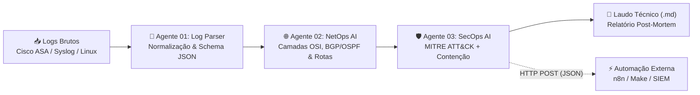

<div align="center">

# 🌐 NetPulse AI Orchestrator
### Pipeline Multi-Agente para Triagem de Logs, Diagnóstico de Redes & Resposta SecOps

[](https://orquestrador-multi-agente-de-logs-dia.netlify.app/)
[](https://www.typescriptlang.org/)
[](https://react.dev/)
[](https://tailwindcss.com/)
[](#)

**Transformando logs brutos de infraestrutura e segurança em diagnósticos de camada OSI, payloads JSON estruturados e playbooks acionáveis de contenção em segundos.**

[🚀 Acessar Aplicação ao Vivo](https://orquestrador-multi-agente-de-logs-dia.netlify.app/) • [🧠 Arquitetura](#-arquitetura-do-pipeline-multi-agente) • [⚡ Funcionalidades](#-principais-funcionalidades) • [💻 Como Executar](#-como-executar-localmente)

</div>

---

## 🎯 Problema & Solução

Em ambientes de **NOC (Network Operations Center)** e **SOC (Security Operations Center)**, analistas perdem tempo crítico correlacionando manualmente milhares de linhas de `syslog`, alertas de firewall e registros de autenticação Linux durante incidentes sob pressão.

O **NetPulse AI Orchestrator** resolve esse gargalo aplicando **Agent Chaining (Encadeamento de Agentes Especializados)**: em vez de depender de um único prompt genérico, a aplicação divide o raciocínio em **3 agentes autônomos sequenciais**, validando dados em JSON a cada etapa e integrando-se nativamente a fluxos externos via **Webhooks (n8n / Make)**.

---

## 🧠 Arquitetura do Pipeline Multi-Agente



### Matriz de Responsabilidades dos Agentes

| Ordem | Agente | Especialidade Técnica | Entrada → Saída |
| :--- | :--- | :--- | :--- |
| **01** | **Log Parser & Normalizer** | Higienização, Regex e tipagem de dados | Texto bruto não estruturado → **JSON tipado** (IPs, portas, protocolos) |
| **02** | **NetOps & OSI Diagnostic** | Engenharia de Redes, roteamento e topologia | JSON normalizado → **Raio de impacto (L1–L7)** e causa raiz de conectividade |
| **03** | **SecOps & Remediation** | Resposta a Incidentes e **MITRE ATT&CK** | Diagnóstico técnico → **SLA de contenção** + comandos (`Cisco`, `UFW`, `iptables`) |

---

## ⚡ Principais Funcionalidades

* **🧪 Laboratório de Cenários Reais (1-Clique):** Simulação imediata com logs reais de **Cisco ASA (SYN Flood & Port Scan)**, **Ubuntu Server (Brute Force SSH + Escalação Sudo)** e **Core Router (BGP/OSPF Flap & Degradação DNS)**.
* **📥 Ingestão Livre de Logs:** Suporte para colar saídas reais de terminais, switches, firewalls ou servidores para triagem instantânea.
* **🔗 Integração Zero-Backend (Webhooks):** Campo nativo para conectar URLs do **n8n** ou **Make**, disparando automaticamente o payload consolidado dos 3 agentes para Slack, Jira, Teams ou SIEM.
* **📋 Playbooks Prontos para Execução:** Comandos de mitigação gerados dinamicamente com o IP/interface extraídos do log, prontos para copiar com um clique.
* **📑 Exportação de Laudo Post-Mortem (`.md`):** Gera e baixa um relatório técnico formatado em Markdown pronto para anexar em chamados ou documentação de incidentes.

---

## 🛠️ Stack Tecnológica

* **Frontend & Interface:** React 19, TypeScript, Tailwind CSS v4, Lucide Icons
* **Motor de Orquestração:** Pipeline assíncrono em TypeScript com máquina de estados por agente (`idle` → `running` → `completed`)
* **Integrações & Automação:** REST API / Webhooks JSON (compatível com n8n, Make, Zapier e APIs de LLMs)
* **Build & CI/CD:** Vite + Deploy contínuo via GitHub & Netlify

---

## 🚀 Como Executar Localmente

```bash
# 1. Clone o repositório
git clone [https://github.com/Rafael777Trajano/Orquestrador-Multi-Agente-de-Logs-Diagn-stico-de-Redes.git](https://github.com/Rafael777Trajano/Orquestrador-Multi-Agente-de-Logs-Diagn-stico-de-Redes.git)

# 2. Acesse o diretório do projeto
cd Orquestrador-Multi-Agente-de-Logs-Diagn-stico-de-Redes

# 3. Instale as dependências
npm install

# 4. Inicie o servidor de desenvolvimento
npm run dev
```

A aplicação ficará disponível em `http://localhost:5173`.

---

## 🧩 Ecossistema de Projetos (Trilha AI Builder — 5 Soluções)

Este repositório faz parte de uma suíte de **5 projetos práticos** focados em **Automação de Processos, Orquestração de IA e Eficiência Operacional**:

| # | Projeto | Foco Técnico | Status |
| :---: | :--- | :--- | :---: |
| **01** | [**SentinelAI SOC Dashboard**](https://sentinelai-soc-dashboard.netlify.app/) | Monitoramento SOC, visualização de alertas e triagem de segurança | ✅ No Ar |
| **02** | [**NetPulse AI Orchestrator**](https://orquestrador-multi-agente-de-logs-dia.netlify.app/) *(Este repositório)* | Orquestração multi-agente para logs de redes, diagnóstico OSI e SecOps | ✅ No Ar |
| **03** | **Unstructured-to-JSON Engine** | Extração estruturada de dados e classificação operacional a partir de textos livres | 🚧 Em Desenvolvimento |
| **04** | **Zero-Backend Webhook Connector** | Integração ágil de eventos operacionais via webhooks (`n8n` / `Make` / `Zapier`) | ⏳ Em Breve (Roadmap) |
| **05** | **OpsProtocol RAG Copilot** | Copiloto de conformidade, consulta rápida a POPs e mediação de crises em tempo real | ⏳ Em Breve (Roadmap) |

---

<div align="center">

### 👨‍💻 Desenvolvido por **Rafael Trajano**
*Tecnólogo em Redes de Computadores • Graduando em Sistemas de Informação*  
**AI Builder | Orquestração de Agentes | Automação de Sistemas | Segurança da Informação**

[](https://www.linkedin.com/in/rafaatrjnbpbs47)
[](https://github.com/Rafael777Trajano)

</div>
